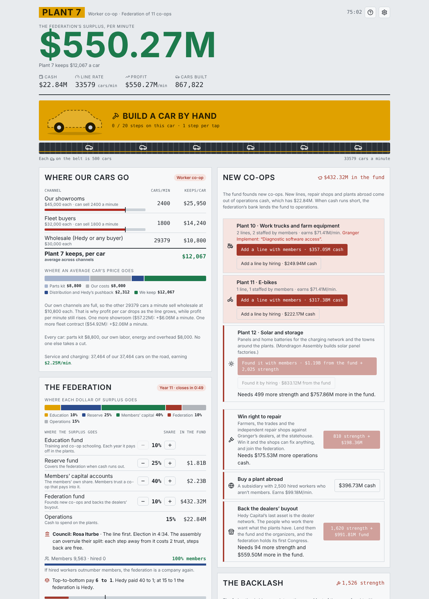
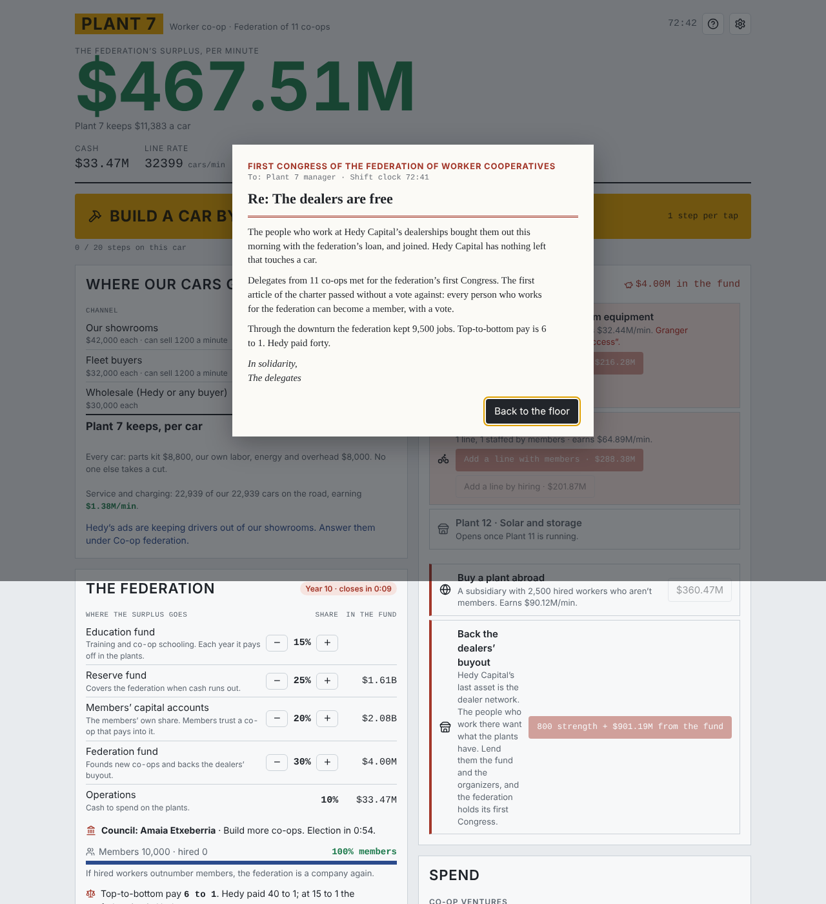
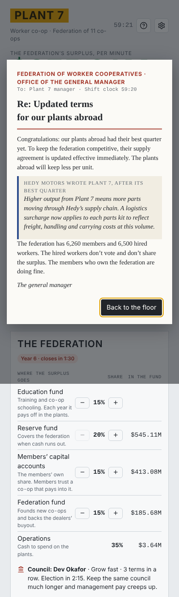
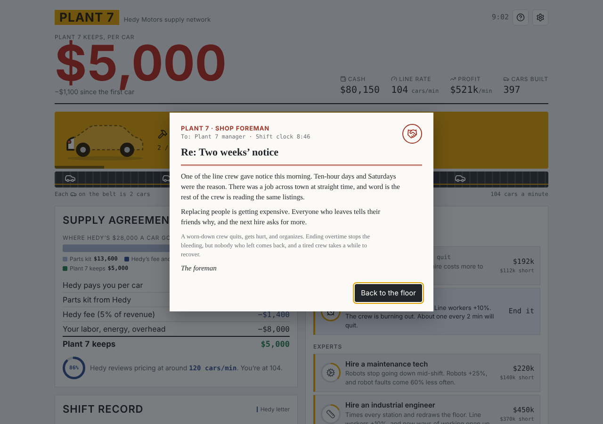
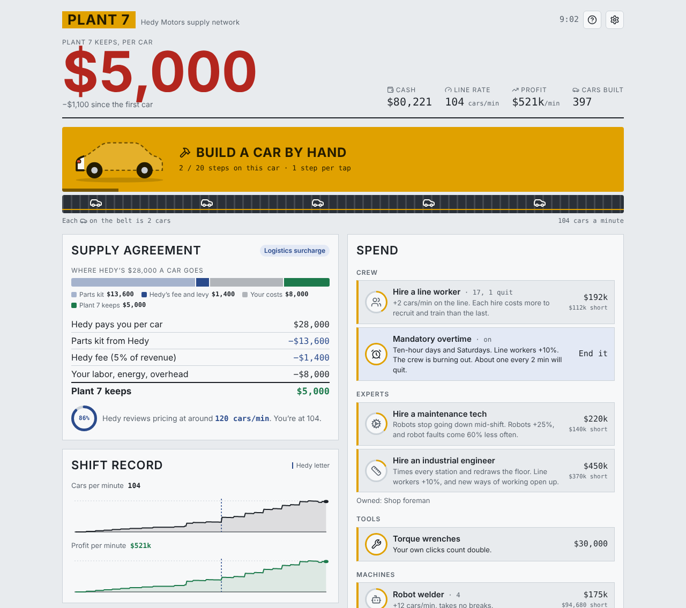
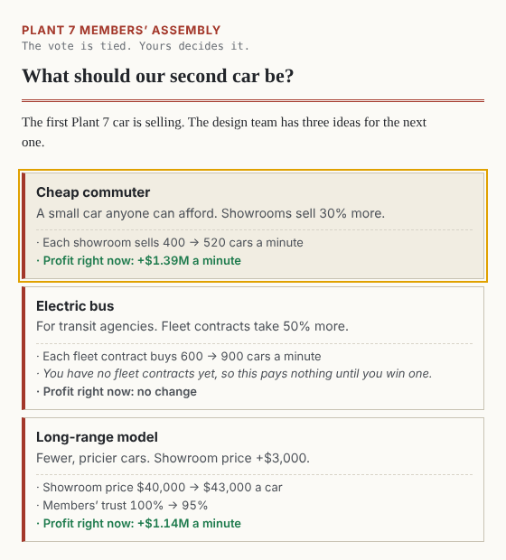
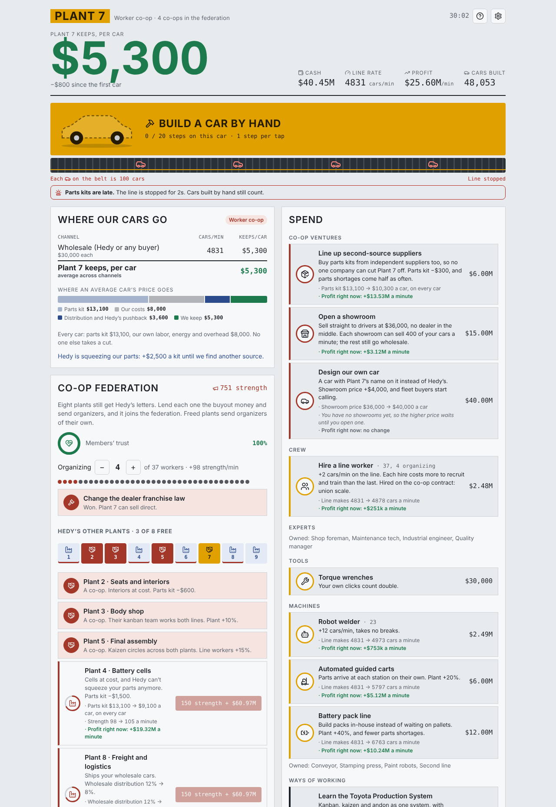

Today's update is the biggest one yet. Hedy Plant gets a whole third act, a new temptation in act 1, a lot more explanation in act 2, and a visual pass across the whole game so it's no longer a wall of text.

## Act 3: run the federation

Until today, Hedy Plant ended the moment you freed the ninth plant. You'd bought out Plant 7, turned eight sister plants into co-ops, and the game said congratulations and rolled credits.

That always felt a little too easy. Winning the plants is the part that makes the news. Keeping them is the hard part, and it's the part almost nobody tells stories about.

Now, free Plant 9 and the game keeps going. Your nine plants are a federation of worker co-ops, loosely modeled on Mondragon in the Basque Country, and you're helping run it.

**The year close.** Every three minutes the federation closes its books and splits the surplus four ways: an education fund (at least 10%), reserves (at least 20%), the members' own capital accounts, and a federation fund for starting new co-ops. Education pays off in the plants the next year. Reserves carry you through bad times. Members trust a co-op that pays into their accounts.

**The council.** Members elect a council from three factions: Rosa (the line first), Dev (grow fast) and Amaia (build more co-ops). If you don't vote, the council decides for you. Leave the same faction in power long enough and management pay starts creeping up. You can overrule the council's split, but every step away from it costs trust.

**New co-ops.** The fund can found a truck and farm equipment co-op (Plant 10), which has to fight the tractor maker Granger's repair lock, and then an e-bike co-op (Plant 11), which sells *more* when money is tight. Founding a co-op with members costs strength as well as money. Hiring is cheaper and faster. Hold that thought.

**The downturn.** Somewhere in the middle of act 3, a recession hits and car orders drop by two thirds for five minutes. The assembly picks one of seven responses, from everyone taking a pay cut together, to moving members to the busy co-ops, to taking Hedy Capital's rescue money.

### The backlash

People ask why, if Mondragon works, there aren't more of them. Act 3 is our answer, and it comes in the form of everyone who would rather you didn't exist:

- **The banks.** Once Plant 10 opens, the federation's credit gets pulled and everything costs 50% more to build, until you found your own bank. The bank also lends the fund to operations when cash runs out.
- **The Main Street Coalition.** First ads keeping drivers out of your showrooms, then a "Fair Competition in Public Contracting Act" that stops towns from buying from co-ops, then a tax challenge in court. Each one hurts until you beat it, mostly with strength.
- **Scandals.** One can break at any year close. An elected audit committee makes them a lot rarer.
- **Ridgeline Partners.** From year 3, a private equity firm starts offering to buy the members out. The offer looks good. Taking it loses the run.

Strength costs in act 3 are scaled to what your organizers were bringing in when Plant 9 fell, so you can't coast through it on a pile saved up from act 2.

### Two ways it can end

If the federation comes through the downturn with trucks and e-bikes of its own and beats the Coalition in court, the dealers' own workers buy out Hedy Capital's dealerships and the federation holds its **First Congress**. That ending leads with how many jobs you kept through the downturn and how wide pay got.

Or you can become Hedy. If hired workers ever outnumber members, or top-to-bottom pay reaches 15 to 1, the federation is just a company again, and the game says so. Growing by hiring is always cheaper and always faster. That's the trap.

## Act 1: mandatory overtime

In act 1 you're a plant manager getting squeezed by Hedy, and until now every lever you had cost money. Now there's one that doesn't.

Once you have three workers, a **Mandatory overtime** card shows up under Crew. Turn it on and your line workers build 50% more, for free. It's genuinely the best move you can make, for about five minutes.

Then the crew wears down. The bonus shrinks to 10%. People start quitting, and every one who leaves makes the next hire more expensive. Injuries double the line stoppages. The extra cars bring Hedy's next price review sooner. And once organizing is open, a worn-out crew starts bringing in strength on its own.

You can end it any time. The quitting stops, but the crew takes ten minutes to recover and nobody who left comes back. In our test runs, overtime for the first five minutes puts you about 8% ahead. Leave it on and you're 7% behind by minute 10 and 15 to 20% behind by minute 20. Buying the plant out ends it for good.

## A car you build by hand, and pictures for the numbers

Beta players told us each column was a wall of text, and they were right. So:

- The **Build a car by hand** button now shows a car that assembles as you tap, Cookie Clicker style.
- Under it, a **conveyor** rolls finished cars off at your real line rate and stops when the line does. Each car on the belt is a labeled batch (1, 2, 5, 10, 20, 50... cars), so it stays readable from your first car to your thirty-thousandth.
- **Where each car's price goes** is now a split bar: the parts kit, Hedy's cut, your costs, and what Plant 7 keeps.
- **Rings** show how close you are to Hedy's next price review, Hedy's share, members' trust and the buyout loan.
- **Shop items** have icons in rings that fill as your cash comes in, so you can see what's almost affordable.
- Your **crew** is a row of dots, with organizers in red.

- In act 2, a **map of the nine plants** shows which are free, and the organizing steps get **strength rings**.
- **Bullet graphs** show how full your showrooms and fleet contracts are, and how close the federation's pay ratio is to 15 to 1.
- The act 3 surplus split is a **split bar** too.
- **Letters** get a seal and a before/after bar of what Plant 7 keeps.

## Act 2 now tells you what your choices do

Act 2 vote options used to say things like "Fleet contracts take 50% more", which didn't tell you whether that was good for *your* plant. Now every vote option, sister plant and co-op shop item runs the game one step ahead and tells you the actual result: how many cars, how much each one sells for, and what it does to your profit per minute right now. If an option can't pay off yet ("You have no fleet contracts yet"), it says that too.

The sales panel also finally explains something a lot of you asked about: why profit per car goes *down* in act 2 while profit per minute goes up. Your showrooms and fleet contracts can only take so many cars. Everything past that sells wholesale at $6,400, so your average per car falls even as you earn more. The panel now says when your channels are full and what one more showroom or fleet contract would add.

## Smaller changes and fixes

- Cars/min now shows what the plant is actually turning out. Cars you build by hand count (a 15-second average, with a small "by hand" line under the number), and profit and both charts include them.
- During a line stoppage, Cars/min turns red and drops by what's lost, and profit, the charts and the belt follow. Hedy's price reviews still go by your normal line rate, so a breakdown or a burst of clicking never triggers one.
- Optional sound effects: quiet cues for taps, finished cars, purchases, line stoppages, letters, votes and the win. Sound starts off; turn it on with the speaker button in the top bar, next to help and settings, and the game remembers your choice.
- The robot welder now "takes no breaks".
- The worker card counts how many people quit.
- The fleet and showroom cards show their current caps instead of the starting numbers.
- New lines say clearly that they're paid from operations cash, not the federation fund.
- The profit chart now matches the profit number above it.
- Plant 7's own workers count as federation members.
- You can turn a hired line into members (it costs strength and some of the fund).
- The grid charge letter explains why the utility wants the fee.
- Disabled act 3 buttons now tell you what they're waiting on ("Needs 1,200 more strength").
- After the run ends, act 3 panels say the act is over instead of showing live-looking buttons and frozen timers.
- Save image and Share on the Congress win screen no longer throw an error.
- Raising the education share right before a year close no longer gives you the whole year's bonus.
- Layoffs now actually close the hired lines instead of hiding the workers while their lines kept running.
- The year letter no longer doubles your capital and fund while the tax case stands, and shows what the state took.
- Hedy Capital's rescue now counts the jobs that leave with it.
- During a recession, "Where our cars go" shows a Recession row and a red total.
- Reserves keep covering red cash if the run ends mid-recession, and the false "lenders call the loans" banner is gone.
- Pulling all your organizers right before Plant 9 no longer makes act 3 fifteen times cheaper.
- The "Make a hired line members" button no longer runs off the edge on phones.
- Wording fixes: "lost 1 times", percentages rounding 2.5% to 3%, missing thousands separators on strength, and an ending that mentioned plants abroad you never bought.

## Your old save

If you already won at Plant 9, you keep your win, and a new "Go on: run the federation" button picks things up from there.

Thanks for playing. If you finish act 3, we'd love to know which ending you got.

— Permadeath Media
