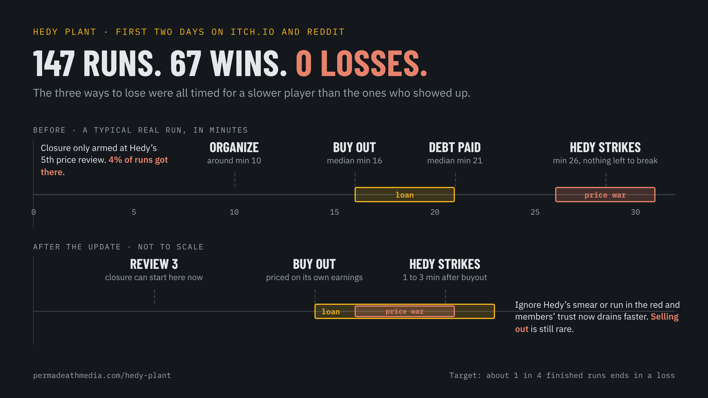
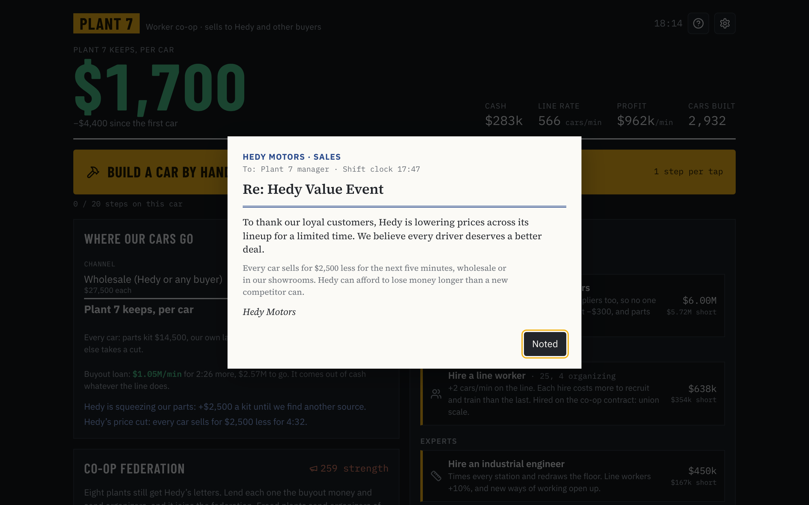
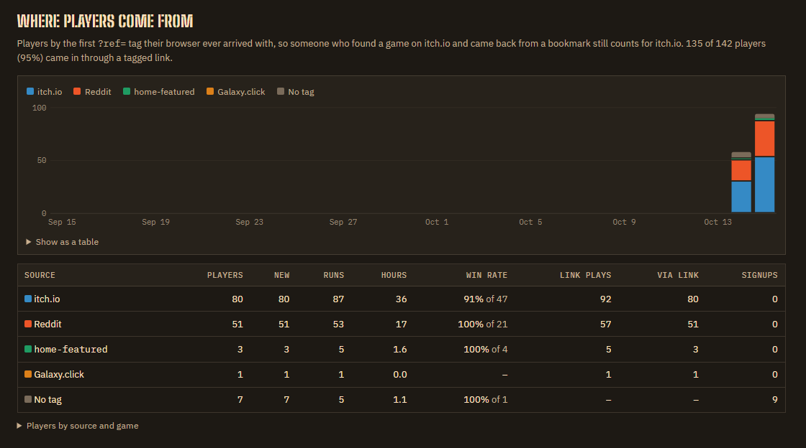

Hedy Plant has been on itch.io for two days. Thank you to everyone who played, and especially to the folks who came over from Reddit and stuck around for twenty minutes at a time.

Here's what the numbers told us: **147 runs, 67 wins, 0 losses.**

That's not a game about organizing. That's a game about clicking until you win. Hedy Plant is supposed to be about a company that answers every gain you make with a new way to take it back, and if Hedy never actually lands a hit, the whole point goes soft.

So we went looking. Losses were being recorded fine. The problem was timing. All three ways to lose were tuned against our test bots, and you are much faster than our test bots:

- **Closure.** Hedy only threatened to move the line after its fifth price review. Most of you organized around minute 10 and bought the plant out around minute 16. Only 4% of runs ever saw that fifth review.
- **Bust.** The buyout loan was usually paid off by minute 21. Hedy's price war showed up around minute 26, against a co-op that no longer owed anyone a cent.
- **Sellout.** Members' trust had to fall 80 points, which took close to half an hour of ignoring Hedy's smear campaign. Nobody did that.

## What's changing

The co-op stage is where every winner passes through, so that's where Hedy now pushes back:

- Hedy's price war starts **a minute or three after you buy out, while you're still paying off the loan**, which is exactly when a real company would do it.
- Hedy now prices the buyout on what Plant 7 would earn on its own, so the loan eats about half the co-op's income while it lasts.
- The closure notice can come as early as **the third price review**. A plant that never organizes now gets shut down around minute 20 instead of 40.
- Ignoring Hedy's smear campaign or running in the red drains members' trust faster. Selling out is still rare, but it's no longer out of reach.

We're aiming for about **one in four finished runs to end in a loss.** You should still win most of the time. You should also feel how close it was.

The win screen got a rework too. It now leads with profit per second, plants freed, how much Hedy took from you along the way, and how many workers and robots it took to get there. The share image puts your co-op's earnings per second up front, with a bar showing what you kept against what Hedy took.

If you beat it before, try it again. Hedy has been reading your numbers too.

— Permadeath Media
